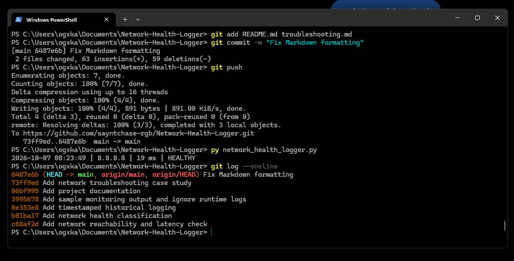

# Network Health Logger


A lightweight Python network-monitoring utility that checks connectivity, measures latency, classifies network health, and records timestamped historical results.


## Purpose


This project was built to practice and demonstrate practical skills in:


- Python scripting

- Network troubleshooting

- ICMP/ping testing

- Latency measurement

- Process return-code handling

- File logging

- Git version control

- Technical documentation


## Features


- Tests connectivity to a network target

- Measures ping latency

- Classifies network status as:

&#x20; - `HEALTHY` — latency of 100 ms or less

&#x20; - `DEGRADED` — latency above 100 ms or unavailable

&#x20; - `DOWN` — ping test fails

- Adds timestamps to each result

- Stores historical results in a local log

- Includes sample monitoring output for review


> The 100 ms threshold is a project-defined threshold and is not intended as a universal networking standard.


## Example Output


```text

2026-10-07 06:51:43 | 8.8.8.8 | 15 ms | HEALTHY

2026-10-07 06:52:34 | 8.8.8.8 | 11 ms | HEALTHY

2026-10-07 06:52:34 | 8.8.8.8 | 10 ms | HEALTHY

```


## Requirements


- Windows

- Python 3

- Network connectivity


Developed using Python 3.11.9.


## Usage


Run from PowerShell:


```powershell

py network_health_logger.py

```


The program displays the current result and appends it to:


```text

network_health.log

```


Runtime log files are excluded from Git using `.gitignore`. A static example is included in `sample_output.txt`.


## Project Structure


```text

Network-Health-Logger/

├── network_health_logger.py

├── sample_output.txt

├── README.md

└── .gitignore

```


## Skills Demonstrated


This project demonstrates basic network diagnostics, Python automation, structured troubleshooting, logging, documentation, and Git-based development.


## Execution Proof

The logger running successfully in Windows PowerShell:


